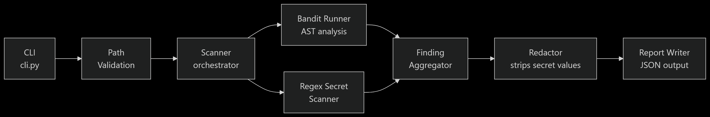

# AEGIS — Application Security & Inspection System
[](https://www.python.org/)
[](https://bandit.readthedocs.io/)
[](https://github.com/)
[](#project-status)

AEGIS is a privacy-focused, local source-code security scanner that detects common Python security issues and potential hardcoded secrets. It combines Bandit-based static analysis with custom secret-detection rules, redacts sensitive evidence, and generates structured JSON reports with remediation guidance.

**AEGIS is designed to scan projects locally without intentionally uploading source code, detected secrets, or reports to a remote service.**

---

## Architecture

The diagram below illustrates the high-level architecture of AEGIS,
from project path validation through security analysis and JSON report generation.



*Figure 1. High-level architecture of AEGIS MVP.*

---

## Features (MVP)

- Python AST-based security analysis via [Bandit](https://bandit.readthedocs.io/). The current security-analysis engine targets Python code.
- Regex-based secret detection (AWS keys, GitHub tokens, API keys, hardcoded passwords)
- Automatic redaction of detected secret values before any report or console output
- Structured JSON report with severity, file, line number, evidence (redacted), and
  remediation guidance
- Safe path handling — never modifies scanned files, rejects output inside the
  scanned project directory

---

## Requirements

- Python 3.13 or later
- Git (for version control)

---

## Setup

```bash
# 1. Clone the repository
git clone https://github.com/SudarshanVasu-creator/AEGIS
cd AEGIS

# 2. Create and activate a dedicated virtual environment
python -m venv .venv

# Windows
.venv\Scripts\activate
# macOS / Linux
source .venv/bin/activate

# 3. Install the package in editable mode (includes runtime dependencies)
pip install -e .

# 4. Install development/test dependencies
pip install -r requirements-dev.txt
```

---

## Usage

```bash
# Scan a project and write the report to report.json
aegis scan --project /path/to/your/project --output report.json
```

Or via the module entry point:

```bash
python -m aegis scan --project /path/to/your/project --output report.json
```

Show help:

```bash
aegis --help
aegis scan --help
```

### Exit codes

| Code | Meaning |
|------|---------|
| `0`  | A report was written; inspect scan_status for SUCCESS or PARTIAL |
| `1`  | Invalid arguments or unsafe input/output path |
| `2`  | All scanner engines failed |
| `3`  | Report could not be written |

---

## Running Tests

```bash
pytest tests/
```

With coverage:

```bash
pytest --cov=aegis --cov-report=term-missing tests/
```

The test suite uses only synthetic fixture projects with fake credentials.
No real credentials are required to run the tests.

---

## Privacy

AEGIS is designed to keep your source code and findings private:

- AEGIS is designed to scan projects locally without intentionally transmitting source code or findings to remote services.
- Detected secret values are redacted before appearing in any output or report.
- The `evidence` field in reports always contains the *redacted* value, never the raw
  secret.
- Scanned project files are never modified.
- Reports are written only to the path you specify, and never inside the scanned
  project directory.
- The `project_name` in reports contains only the final directory component of the
  scanned path, not the full absolute path.

**Caveats:** These guarantees apply to AEGIS itself. AEGIS does not control OS-level
telemetry, editor integrations, or the security of the output report file after it
is written.
AEGIS redacts recognized secret patterns before including finding evidence in reports. Detection and redaction are pattern-based and cannot guarantee that every possible secret format will be recognized.

See [docs/architecture.md](docs/architecture.md) for a full description of the design
and the specific tests that verify each guarantee.

---

## Contributing

1. Fork the repository and create a feature branch.
2. Write or update tests for any behaviour you change.
3. Run `pytest tests/` and confirm all tests pass before opening a pull request.
4. Do not commit real credentials, private source code, or generated scan reports.
5. Do not add dependencies without discussion — minimal dependencies are a design goal.

---

## License

License not yet selected. See project discussions.

---

## Status

MVP complete. All planned scanner engines, redaction, report writing, CLI, and
end-to-end tests are implemented and passing.
